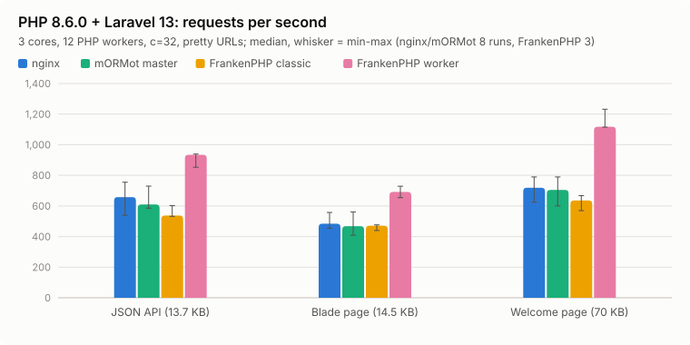
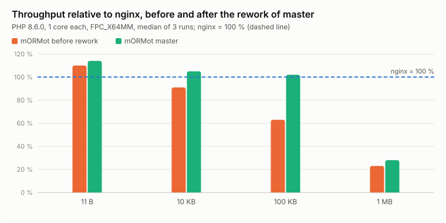
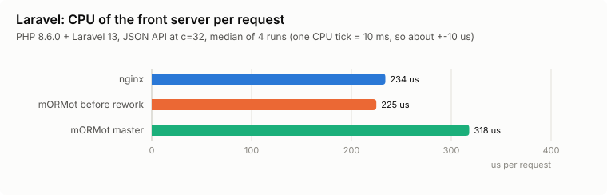
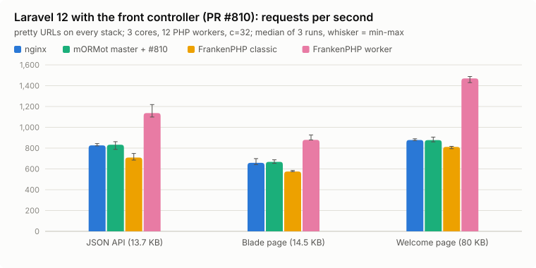
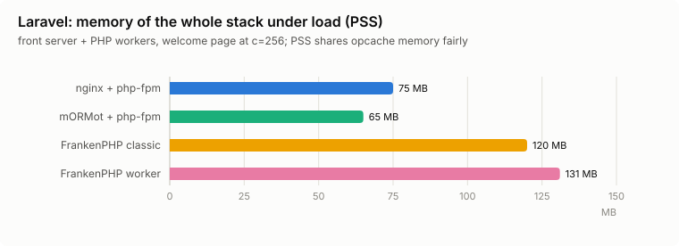
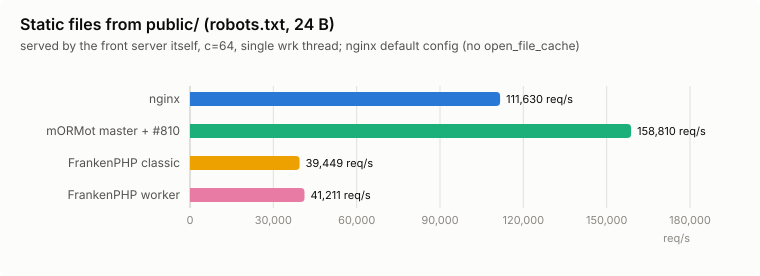
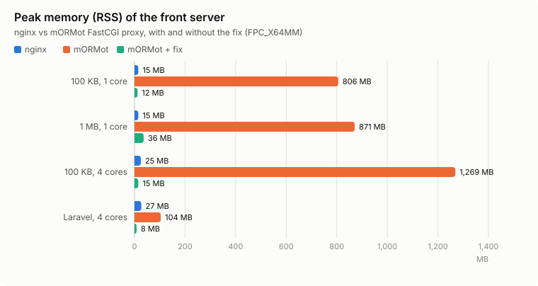
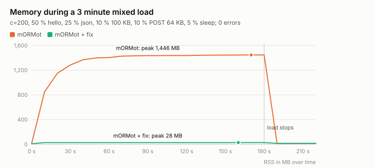
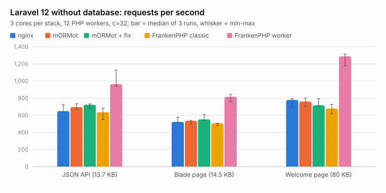
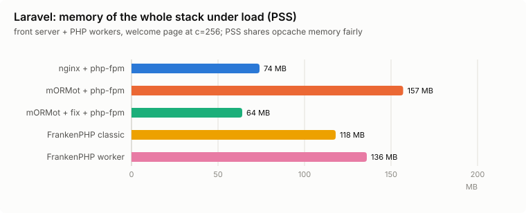

# mORMot 2 FastCGI proxy vs nginx and FrankenPHP

Benchmark of the `fcgi://` source of `THttpProxyServer`, added in
[synopse/mORMot2#785](https://github.com/synopse/mORMot2/pull/785). It answers the question
asked in [that PR](https://github.com/synopse/mORMot2/pull/785#issuecomment-6955274832) about
stability, performance and CPU/RAM usage compared to nginx. It uses php-fpm and FrankenPHP, a
synthetic PHP workload, and a real Laravel application. The latest run uses **PHP 8.6.0** with
Laravel 13; earlier runs used PHP 8.5.12 with Laravel 12.

The fix proposed from these measurements,
[`b86a573`](https://github.com/synopse/mORMot2/commit/b86a573) "net: release FastCGI connection
buffers on close", is merged in synopse/mORMot2 master. It was followed by further optimizations
from Arnaud Bouchez, e.g. `df127cf` "much faster TFastCgiAsyncConnections local connections" and
`a1c160f` "FastCGI connections share the TAsyncConnections of the HTTP server". The
front-controller gap found here is addressed by
[synopse/mORMot2#810](https://github.com/synopse/mORMot2/pull/810) (`FastCgiIndex`), now merged.

## Update 2026-11-21: PHP 8.6.0, Laravel 13 and mORMot master

| Item | Version or setting |
|---|---|
| PHP | 8.6.0, built from the `php-8.6.0` tag: NTS + php-fpm and ZTS + embed, opcache on, JIT off |
| mORMot 2 | master [`883701d`](https://github.com/synopse/mORMot2/commit/883701d), which includes #810, #811 and `a1c160f`; FPC 3.2.2, `-dFPC_X64MM -dFPCMM_SERVER`, `FastCgiIndex = 'index.php'` |
| FrankenPHP | v1.14.0 (tagged 2026-11-21, Caddy v2.11.9), built from source against the same PHP 8.6.0 ZTS. The official v1.13.6 binaries and images still embed PHP 8.5.13. |
| Laravel | **13.43.0** + Octane, with the same benchmark app (controller, views, routes) and settings as before |
| nginx | 1.24.0 with `try_files $uri $uri/ /index.php?$query_string` |

**Why Laravel 13:** Laravel 12.73.0, its latest release and also the current `12.x` branch, is not
ready for PHP 8.6. PHP 8.6 warns when a class implements `SessionHandlerInterface` without
`create_sid()` (required in PHP 9). Laravel 12 turns that warning into an exception, so the
welcome page returned 500, and `spl_object_hash()` raises deprecations. Laravel 13.43 implements
`create_sid()` in all its session handlers and runs without any warning on PHP 8.6.

This run was on a different host from the earlier ones: nginx served static files about 15 %
slower than on 2026-11-19. Compare the figures only within this section.

**Summary**
- **Compatibility:** with PHP 8.6 and Laravel 13, nginx `try_files`, the mORMot front controller and
  FrankenPHP returned the same answers ([results/php86-compat.txt](results/php86-compat.txt),
  `laravel/compat.sh`). The only differences are the same as before: `/up` prints a timing, and
  path traversal returns 400 with nginx and 404 with the others.
- **PHP 8.6 vs 8.5:** on the same Laravel 13 app, behind nginx, PHP 8.6.0 is as fast as 8.5.12
  (0 to +3 %, within noise; [results/php85-vs-86-laravel13.txt](results/php85-vs-86-laravel13.txt)).
- **Laravel throughput:** nginx and mORMot master are close. At c=32, the median of 8 interleaved
  runs is 2-7 % in favor of nginx, with largely overlapping ranges. At c=256 they are equal
  (mORMot vs nginx: 614 vs 615, 526 vs 541 and 710 vs 683 req/s). FrankenPHP worker is 1.4-1.6x faster, and
  FrankenPHP classic is 3-18 % slower.
- **Arnaud's rework of master closes the large-response gap.** Synthetic, 1 core: at 100 KB
  mORMot master reaches **102 % of nginx**, against 63 % before the rework. At 10 KB it reaches
  105 % (91 % before). Context switches dropped from 23 to 0.2 per request at 100 KB, and from 73
  to 4.4 at 1 MB. 1 MB responses are still at 28 % of nginx.
- **One regression to look at:** with a slow backend (Laravel, about 40 ms per request), the
  master front uses **about 40 % more CPU per request** than before the rework: 318 us against
  225 us, with nginx at 234 us. It also has 6.3 context switches per request, against 4.6 before
  and 2.9 for nginx. This is probably the reason for the small c=32 gap above.
- **Memory and stability:** the mORMot front stays at 7-8 MB RSS under load, against 27 MB for
  nginx with 3 workers. A 2 min mixed soak at c=100 completed 77,465 requests with 0 errors, at a
  constant 8 MB RSS with 7 threads.
- **Static files** (`robots.txt`, c=64): 124 k req/s for mORMot, 96 k for nginx with its default
  configuration, and 28-29 k for FrankenPHP.

<picture>
  <source media="(prefers-color-scheme: dark)" srcset="charts/php86-laravel-throughput-dark.svg">
  
</picture>

Requests per second at c=32: the median of 8 interleaved runs for nginx and mORMot and of 3 runs
for FrankenPHP; the full range is in the chart.

| Endpoint | nginx + php-fpm | mORMot master + php-fpm | FrankenPHP classic | FrankenPHP worker |
|---|---:|---:|---:|---:|
| JSON API (13.7 KB) | 658 | 610 | 537 | 934 |
| Blade page (14.5 KB) | 484 | 468 | 471 | 692 |
| Welcome page (70 KB in Laravel 13) | 719 | 705 | 636 | 1,117 |

Under load at c=256 (one run each):

| | JSON API req/s | p99 | front RSS | stack PSS | front fds | threads |
|---|---:|---:|---:|---:|---:|---:|
| nginx (3 workers) + php-fpm | 615 | 528 ms | 27 MB | 76-77 MB | 559-561 | 4 processes |
| mORMot master + php-fpm | 614 | 467 ms | 7-8 MB | 66-67 MB | 520 | 7 |
| FrankenPHP classic | 546 | 562 ms | 161 MB | 120 MB | 275-276 | 23 |
| FrankenPHP worker | 1,022 | 327 ms | 179-181 MB | 139-140 MB | 277 | 37 |

<picture>
  <source media="(prefers-color-scheme: dark)" srcset="charts/php86-synthetic-throughput-dark.svg">
  
</picture>

Synthetic PHP scripts on PHP 8.6.0, 1 core per front server, median of 3 interleaved runs
([results/php86-synthetic-sizes.txt](results/php86-synthetic-sizes.txt),
[results/php86-ctxswitch.txt](results/php86-ctxswitch.txt)). "Before rework" is `bbbb264` with
the fix:

| Response | nginx req/s | before rework req/s | master req/s | CPU per request: nginx / before / master | context switches per request: before / master |
|---|---:|---:|---:|---:|---:|
| 11 B | 21,070 | 23,229 | 23,923 | 47 / 42 / 41 us | 5.0 / 0.2 |
| 10 KB | 17,028 | 15,510 | 17,803 | 52 / 58 / 52 us | - |
| 100 KB | 10,248 | 6,430 | 10,416 | 96 / 153 / 94 us | 23 / 0.2 |
| 1 MB | 1,561 | 360 | 441 | 632 / 2,750 / 2,250 us | 73 / 4.4 |

<picture>
  <source media="(prefers-color-scheme: dark)" srcset="charts/php86-front-cpu-dark.svg">
  
</picture>

The A/B test of the front servers in front of the same Laravel 13 / PHP 8.6 php-fpm
([results/php86-ab-rework.txt](results/php86-ab-rework.txt), `laravel/run-php86-ab.sh`):

| JSON API, c=32, 4 interleaved runs | req/s (median) | front CPU | CPU per request | context switches per request |
|---|---:|---:|---:|---:|
| nginx | 711 | 16.6-16.8 % | 230-250 us | 2.9-3.0 |
| mORMot before rework (#810, `29820f9`) | 706 | 15.4-16.3 % | 214-238 us | 4.4-5.0 |
| mORMot master (`883701d`) | 688 | 20.9-22.9 % | 305-350 us | 6.0-6.8 |

Other raw data:
[php86-repeat-3x.txt](results/php86-repeat-3x.txt),
[php86-repeat-5x-nginx-mormot.txt](results/php86-repeat-5x-nginx-mormot.txt),
[php86-matrix.txt](results/php86-matrix.txt), [php86-static.txt](results/php86-static.txt),
[php86-soak.txt](results/php86-soak.txt), [php86-soak-wrk.txt](results/php86-soak-wrk.txt).

Reproduce:
```bash
PHP_VERSION=8.6.0 php/build-php.sh                      # /opt/php86 and /opt/php86zts
FRANKENPHP_VERSION=v1.14.0 PHP_ZTS=/opt/php86zts SUFFIX=-1.14-php86 php/build-frankenphp.sh
MORMOT_ROOT=<mORMot master checkout> proxy/build.sh master883
LARAVEL_VERSION='13.*' LARAVEL_APP=/srv/laravel13/app PHPX=86 laravel/setup.sh
export PHPX=86 LARAVEL_APP=/srv/laravel13/app FRANKENPHP=$PWD/php/bin/frankenphp-1.14-php86 \
       MORMOT_FRONT=$PWD/proxy/bin/fcgiproxy_master883
laravel/start.sh && laravel/compat.sh && laravel/run-matrix.sh php86 && laravel/run-php86-extra.sh
laravel/stop.sh && laravel/run-php86-ab.sh && synthetic/run-php86-sizes.sh
```

### PHP 8.6 ZTS overhead (NTS vs ZTS)

PHP 8.6 makes ZTS (thread-safe) builds faster. ZTS is what FrankenPHP and other threaded SAPIs
use; php-fpm uses NTS. According to the PHP 8.6.0 `NEWS` and `UPGRADING.INTERNALS`:
- the engine globals `CG`, `EG`, `SCNG` and `AG` are now compile-time offsets;
- `AG` and `SCNG` live in native `__thread` storage;
- PIE executables use the local-exec TLS model;
- static extensions use `TSRMG_STATIC`.

Wall-clock time is too noisy on this VM to show the difference
([results/php86-zts-overhead.txt](results/php86-zts-overhead.txt)). The executed instructions,
counted with valgrind callgrind, are deterministic
([results/php86-zts-instructions.txt](results/php86-zts-instructions.txt),
`php/zts-instructions.sh`):

| | `Zend/bench.php` | Laravel 13 JSON request (in a CLI loop, boot excluded) |
|---|---:|---:|
| 8.5.12 ZTS vs NTS | +5.0 % instructions | +4.1 % |
| 8.6.0 ZTS vs NTS | +1.7 % | +1.2 % |
| 8.6.0 vs 8.5.12, ZTS build | -3.0 % | -2.6 % |
| 8.6.0 vs 8.5.12, NTS build | +0.2 % | +0.2 % |

The ZTS overhead drops by about two thirds, which helps FrankenPHP; NTS php-fpm is unchanged.
This does not explain the end-to-end gap of FrankenPHP classic against php-fpm (3-18 % above),
which comes from its request handling, not from ZTS.

## Update 2026-11-19: front controller (PR #810) with Laravel 12

Tested source: synopse/mORMot2 master [`9d39b36`](https://github.com/synopse/mORMot2/commit/9d39b36)
with PR #810 merged on top ([`29820f9`](https://github.com/synopse/mORMot2/commit/29820f9), a
fast-forward), built with FPC 3.2.2 and `-dFPC_X64MM -dFPCMM_SERVER`. The proxy runs with
`THttpProxyUrlSettings.FastCgiIndex = 'index.php'`, so every stack now uses the same pretty URLs
(`/page`, `/api/items`, `/`). Same machine, same PHP 8.5.12, same Laravel 12.73 app and settings
as below. The figures were measured in a new run, so compare them only within this section.

**Summary**
- **Same answers as nginx `try_files`:** on 24 checks, the mORMot front controller returned the
  same status codes and the same bodies as nginx. The checks covered the app routes, query
  strings, `/index.php` and `/index.php/page`, Laravel 404 pages, `robots.txt` and
  `favicon.ico` from `public/`, HEAD, 405 on POST to a static file, 304 with
  `If-Modified-Since`/`If-None-Match`, ranges and path traversal. The only exceptions were `/up`
  (it prints a timing) and traversal (nginx 400, mORMot and FrankenPHP 404). Laravel no longer
  generates links with `/index.php`.
- **Laravel throughput is the same as nginx** (within ±1.5 %), with the same p99 latency.
- **The whole stack uses less memory than nginx:** under load the mORMot front stays at 7-8 MB
  RSS, against 26 MB for nginx (3 workers). With php-fpm, that is 64-65 MB PSS against 74-75 MB.
- **FrankenPHP:** in classic mode it is 8-14 % slower than php-fpm behind nginx or mORMot. In
  worker mode (Octane) it is 1.34-1.67x faster, but needs 1.75-2x the memory (130 MB PSS).
- **Static files from `public/`:** 159 k req/s for mORMot, against 112 k for a default nginx and
  about 40 k for FrankenPHP. mORMot serves small files from its memory cache; nginx's default
  configuration opens and sends the file on each request. nginx used less CPU per request
  (11-12 us against 13-14 us), so this compares default configurations, not raw efficiency.
- **Stability:** a 2 min mixed soak (85 % Laravel routes, 15 % static file, c=100) completed
  105,254 requests with 0 errors. RSS stayed at 8 MB, about 210 fds were open, and 9 threads ran.

<picture>
  <source media="(prefers-color-scheme: dark)" srcset="charts/laravel-810-throughput-dark.svg">
  
</picture>

Requests per second, median of 3 interleaved runs at c=32 (p99 latency in brackets):

| Endpoint | nginx + php-fpm | mORMot master + #810 + php-fpm | FrankenPHP classic | FrankenPHP worker |
|---|---:|---:|---:|---:|
| JSON API | 826 (53 ms) | 832 (55 ms) | 709 (82 ms) | 1,137 (56 ms) |
| Blade page | 658 (67 ms) | 668 (67 ms) | 575 (92 ms) | 879 (70 ms) |
| Welcome page | 878 (55 ms) | 877 (53 ms) | 812 (74 ms) | 1,470 (43 ms) |

At c=256 (one run each), in req/s:

| Endpoint | nginx | mORMot | FrankenPHP classic | FrankenPHP worker |
|---|---:|---:|---:|---:|
| JSON API | 788 | 815 | 681 | 1,154 |
| Blade page | 612 | 648 | 582 | 930 |
| Welcome page | 883 | 849 | 784 | 1,601 |

<picture>
  <source media="(prefers-color-scheme: dark)" srcset="charts/laravel-810-memory-dark.svg">
  
</picture>

Under load (c=256):

| | front RSS | stack PSS | front fds | threads | stack CPU per JSON request |
|---|---:|---:|---:|---:|---:|
| nginx (3 workers) + php-fpm | 26-27 MB | 74-75 MB | 561 | 4 processes | 3.8 ms |
| mORMot master + #810 + php-fpm | 7-8 MB | 64-65 MB | 523 | 9 | 3.7 ms |
| FrankenPHP classic | 151 MB | 119-120 MB | 276 | 22 | 4.3 ms |
| FrankenPHP worker | 161-163 MB | 130-131 MB | 277 | 45 | 2.5 ms |

<picture>
  <source media="(prefers-color-scheme: dark)" srcset="charts/laravel-810-static-dark.svg">
  
</picture>

| Static file, c=64 | nginx | mORMot master + #810 | FrankenPHP classic | FrankenPHP worker |
|---|---:|---:|---:|---:|
| `robots.txt` (24 B) | 111,630 req/s, 12 us/req | 158,810 req/s, 14 us/req | 39,449 req/s | 41,211 req/s |
| `favicon.ico` (0 B) | 117,121 req/s, 11 us/req | 158,398 req/s, 13 us/req | 38,377 req/s | 40,525 req/s |

wrk ran with a single thread, and nginx was not CPU-bound in this test (131 % of 3 cores), so the
static figures are a lower bound for nginx.

The `TNetworkProtocols` regression tests pass on master + #810 (see
[results/update-810-tests.txt](results/update-810-tests.txt)). Raw data:
[update-810-repeat-3x.txt](results/update-810-repeat-3x.txt),
[update-810-matrix.txt](results/update-810-matrix.txt),
[update-810-static.txt](results/update-810-static.txt),
[update-810-soak.txt](results/update-810-soak.txt) (RSS MB, fds, threads every 10 s),
[update-810-soak-wrk.txt](results/update-810-soak-wrk.txt),
[update-810-compat.txt](results/update-810-compat.txt).
To reproduce it, see [Reproduce](#reproduce) and `laravel/run-matrix.sh`.

## Summary (2026-11-17, before PR #810)

- **The mORMot asynchronous HTTP server keeps up with nginx.** On one core, for small PHP
  responses, the proxy matched nginx (97-110 % of its requests/s) with comparable CPU per request.
  On 4 cores it matched nginx with 4 workers. With a real Laravel application, nginx and mORMot are
  within run-to-run noise. Congratulations to Arnaud Bouchez on the HTTP server framework.
- **Stability:** 2 million requests of mixed load, failure injection (php-fpm stopped, clients
  aborting, 5000 connections, saturated php-fpm backlog, script timeout): 0 errors and no crash.
  File descriptors went back to their baseline count.
- **Memory:** without the fix, the proxy's peak RSS went up to **0.8-1.45 GB**, against
  **10-40 MB** with the fix (nginx needs 15-27 MB). Closed one-shot FastCGI connections kept their
  receive buffer while they waited in the connection garbage-collector lists. The fix is 3 lines.
- **Large responses** (100 KB and more) are still slower than nginx: 56-64 % of nginx at
  100 KB and 22 % at 1 MB on one core. The proxy buffers the whole response and crosses several
  threads per request, while nginx streams from one event loop. This is a design topic, not part of
  the fix.
- **Laravel:** no difference between nginx and mORMot in front of php-fpm. FrankenPHP in
  worker mode (Laravel Octane) is 1.5-1.65x faster, as expected without a per-request bootstrap,
  but needs 1.7-1.8x the memory of the php-fpm stacks.
- **Gaps for PHP frameworks:** there is no front-controller fallback (`/page` returns 404, only
  `/index.php/page` works), and static files under the FastCGI root are sent to php-fpm.
  Both are addressed by PR #810; see the update above.

All mORMot binaries were built with `FPC_X64MM` (`-dFPC_X64MM -dFPCMM_SERVER`), the
recommended memory manager for servers. The default FPC heap was clearly slower: 10 KB responses
reached 66 % of nginx with it, against 97 % with `FPC_X64MM`.

## Setup

| Item | Version or setting |
|---|---|
| Host | Linux x86_64 VM, 4 vCPU, 16 GB, Ubuntu 24.04, kernel 6.18 |
| mORMot 2 | master [`bbbb264`](https://github.com/synopse/mORMot2/commit/bbbb264) (first runs: `1bc774a`, no change in `src/net` between the two), FPC 3.2.2, `-O3 -dFPC_X64MM -dFPCMM_SERVER` |
| PHP | 8.5.12 built from the `php-8.5.12` tag: NTS + php-fpm, ZTS + embed for FrankenPHP; opcache on, JIT off |
| nginx | 1.24.0, `access_log off`, `fastcgi_pass` on the same unix socket |
| FrankenPHP | v1.13.5 (Caddy v2.11.9), built against the same PHP 8.5.12 |
| Laravel | 12.73.0 + Octane 2.25, `APP_ENV=production`, `artisan optimize`, cookie sessions, no database |
| Load | `wrk` with keep-alive connections, on its own CPU |

- **Synthetic runs:** the proxy (nginx or mORMot) runs pinned to CPU 0, php-fpm (16 static workers)
  to CPU 1-2, and wrk to CPU 3.
- **Laravel runs:** each stack gets CPU 0-2 and 12 PHP workers, and wrk runs on CPU 3.

## 1. Throughput by response size

<picture>
  <source media="(prefers-color-scheme: dark)" srcset="charts/synthetic-throughput-dark.svg">
  
</picture>

Requests per second, 1 core per proxy, c=64 (1 MB: c=16):

| PHP script | nginx | mORMot | mORMot + fix | mORMot CPU per request | nginx CPU per request |
|---|---:|---:|---:|---:|---:|
| `hello.php` (11 B) | 20,166 | 20,020 | 22,248 | 44-48 us | 49 us |
| `json.php` (10 KB) | 15,661 | 15,254 | 15,341 | 61 us | 53 us |
| `big.php` (100 KB) | 9,808 | 5,457 | 6,232 | 158-180 us | 100 us |
| `big.php` (1 MB) | 1,543 | 333 | 338 | 2.6-3.0 ms | 0.64 ms |
| `post.php` (64 KB POST) | 7,317 | 7,639 (FPC heap) | - | 107 us | 81 us |

4 cores, no pinning (nginx 4 workers, mORMot 8 threads), requests per second:

| | nginx | mORMot | mORMot + fix |
|---|---:|---:|---:|
| hello, c=256 | 30,120 | 30,071 | 32,450 |
| json, c=256 | 19,854 | 19,150 | 18,611 |
| 100 KB, c=64 | 14,539 | 9,594 | 12,158 |

Run-to-run noise on this VM is about ±10 %. The same comparison on `bbbb264` is in
[results/synthetic-1core-bbbb264.txt](results/synthetic-1core-bbbb264.txt).

## 2. Memory: the fix

<picture>
  <source media="(prefers-color-scheme: dark)" srcset="charts/memory-peak-dark.svg">
  
</picture>

<picture>
  <source media="(prefers-color-scheme: dark)" srcset="charts/soak-rss-dark.svg">
  
</picture>

**Cause.**
- **One connection per request.** `TFastCgiAsyncConnection` serves a single request, since no
  `FCGI_KEEP_CONN` is set.
- **Closed connections keep their buffer.** Once closed, an instance waits in the
  `TAsyncConnections` GC lists, 100 ms in GC#1 then up to 10 s in GC#2, before it is recycled or
  freed. It keeps its `fRd` buffer meanwhile, which `ReadMaxBytes` (1 MB by default) lets grow to
  the whole response.
- **Instrumented build.** At 5.5 k req/s of 100 KB responses, GC#1 held about **6,000 closed
  instances with 680 MB of `fRd` buffers**, and GC#2 stayed empty, so nothing was recycled under
  load ([results/gc-instrumentation.txt](results/gc-instrumentation.txt)).
- **Not a leak.** The memory goes back to about 10 MB about 10 s after the load stops.

**Fix** (`src/net/mormot.net.proxy.pas`, [fix.diff](fix.diff)):

```pascal
procedure TFastCgiAsyncConnection.OnClose;
begin
  HttpResponse(HTTP_BADGATEWAY); // closed with no frtEndRequest
  fRd.Clear; // one request per connection: don't keep this buffer in the GC
  fResponse.Init;
end;
// in TFastCgiAsyncConnections.Create, after inherited Create:
  fSockets.ReadMaxBytes := 128 shl 10; // parse 64KB records as they come
```

Peak RSS of the front server (MB):

| Scenario | nginx | mORMot | mORMot + fix |
|---|---:|---:|---:|
| 100 KB, 1 core, c=64 | 15 | 806 | 12 |
| 1 MB, 1 core, c=16 | 15 | 871 | 36 |
| 1 MB, 1 core, on `bbbb264` | - | 996 | 36 |
| 100 KB, 4 cores, c=64 | 25 | 1,269 | 15 |
| 3 min mixed load, c=200 | - | 1,446 | 28 |
| Laravel welcome page, c=256 | 27 | 104 | 8 |

The throughput is unchanged within noise; the benefit of the fix is the memory.
The `TNetworkProtocols` regression tests pass with the fix (3 runs, 177,148 assertions, 0 failed).

## 3. Stability (without the fix)

| Test | Result |
|---|---|
| 3 min mixed load (hello, json, 100 KB, POST 64 KB, 20 ms sleep), c=200 | 2.0 M requests, 0 errors, 11.1 k req/s, same as nginx |
| php-fpm stopped under load | immediate 502 (0.6 ms, same as nginx); 200 again right after the restart |
| 2000 clients aborting a 1 MB response after 2 ms | no crash; open file descriptors back to 8 |
| 5000 concurrent keep-alive clients | 19.1 k req/s, no errors |
| php-fpm backlog saturated (2 workers, `listen.backlog=8`, 200 clients on a 1 s script) | HTTP threads not blocked in `connect()`; a non-PHP probe answered in 0.5 ms |
| script running 70 s | 504 after 60.1 s (`FastCgiTimeoutSec`) |
| 2 min Laravel soak, c=100 | 0 errors, stable fds; RSS 73 -> 94 MB without the fix, 8 MB with it |

## 4. Laravel 12 without database

The app has three endpoints, all under the `web` or `api` middleware:
- a JSON API (13.7 KB, a collection of 100 items),
- a Blade page (14.5 KB, with layout, partials, CSRF and 3 encrypted cookies),
- the default welcome page (80 KB).

<picture>
  <source media="(prefers-color-scheme: dark)" srcset="charts/laravel-throughput-dark.svg">
  
</picture>

Requests per second, median of 3 interleaved runs, c=32:

| Endpoint | nginx + php-fpm | mORMot + php-fpm | mORMot + fix | FrankenPHP classic | FrankenPHP worker |
|---|---:|---:|---:|---:|---:|
| JSON API | 648 | 695 | 722 | 634 | 963 |
| Blade page | 522 | 535 | 551 | 506 | 814 |
| Welcome page | 779 | 760 | 716 | 678 | 1,288 |

PHP is the bottleneck here: the front server (nginx or mORMot) used only 12-24 % of the 3 cores.

<picture>
  <source media="(prefers-color-scheme: dark)" srcset="charts/laravel-memory-dark.svg">
  
</picture>

Memory and handles. PSS splits shared pages between processes, so it is the fair measure for
php-fpm, whose workers share the opcache memory.

| | RSS at idle after load | PSS at idle | fds at idle | fds at c=256 | threads |
|---|---:|---:|---:|---:|---:|
| nginx (3 workers) | 26 MB | 16 MB | 49 | 560 | 4 processes |
| mORMot | 12 MB | 10 MB | 8 | 520 | 9 |
| mORMot + fix | 8 MB | 6 MB | 8 | 520 | 9 |
| php-fpm (12 workers, used by both) | 398 MB | 57 MB | 93 | 105 | 13 processes |
| FrankenPHP classic | 143 MB | 103 MB | 9 | 276 | 22 |
| FrankenPHP worker | 161 MB | 121 MB | 21 | 277 | 35 |

## 5. Where the gap for large responses comes from

Measured per request on one core with `FPC_X64MM`:

| | hello | 100 KB | 1 MB |
|---|---:|---:|---:|
| Context switches, mORMot | 7.1 | 17 | 76 |
| Context switches, nginx | 0 | 0 | 0 |
| Minor page faults, mORMot | - | 6-9 | 274-278 |
| Minor page faults, nginx | - | 0 | 1 |

- **Buffering and copies.** The response is buffered completely, copied from `fRd` to
  `TFastCgiResponse.Output`, and moved again by `FastCgiParseOutput`.
- **Thread hops.** Each request passes through an HTTP worker thread, the `fastcgi` reader thread,
  and then the HTTP writer.
- **Profile.** At 100 KB, 78 % of the profile samples are in the kernel, and 37 % of all samples
  are scheduling and wake-ups.

Possible directions, all to be measured:
- streaming large outputs to the client, as nginx does with `fastcgi_buffers`;
- fewer thread hand-offs per request;
- `FCGI_KEEP_CONN` with a pool bounded by the php-fpm workers (see section 6).

## 6. Notes for PHP frameworks and handles

- **No front-controller fallback.** Laravel, Symfony and WordPress rely on
  `try_files $uri /index.php`. With the proxy, `/page` returns 404 and only `/index.php/page`
  works, so Laravel also generates links containing `/index.php`.
- **Static files under the FastCGI root are sent to php-fpm.** `robots.txt` returns 403, from
  php-fpm `security.limit_extensions`, and `favicon.ico` returns the built-in mORMot icon instead of
  the app's file. A "serve the file if it exists, else forward to the front controller" mode would
  cover both points.
- **FastCGI over TCP.** One connection per request left about 8,400 `TIME_WAIT` sockets after
  15 s at 770 req/s, exactly like nginx's default `fastcgi_pass`. Against a remote php-fpm this can
  exhaust ephemeral ports at a few hundred new connections per second.
- **Keeping connections open is not free.** A naive nginx `fastcgi_keep_conn` + `keepalive` setup
  dropped to 245 req/s, a third of the throughput, because idle kept connections block php-fpm
  workers. A future `FCGI_KEEP_CONN` pool in mORMot should be bounded by `pm.max_children`.

## Limits of this benchmark

- One VM, with the load generator on the same host; noise is about ±10 %.
- Linux x86_64 with epoll and FPC only. Windows/IOCP, Delphi builds and aarch64 were not tested.
- FastCGI over a unix socket, except for the TCP handle test in section 6.
- No TLS and no HTTP/2.

## Reproduce

Requirements: FPC 3.2.x, the mORMot static libraries in `static/x86_64-linux`, nginx, wrk,
composer, Go (for FrankenPHP) and the PHP build dependencies listed in `php/build-php.sh`.
All paths below are relative to this folder.

```bash
php/build-php.sh                         # PHP 8.5.12: /opt/php85 (fpm) and /opt/php85zts (embed)
php/build-frankenphp.sh                  # FrankenPHP v1.13.5 -> php/bin/frankenphp
proxy/build.sh upstream                  # proxy/bin/fcgiproxy_upstream (FPC_X64MM)
git apply --ignore-whitespace fix.diff && proxy/build.sh fix && git apply -R --ignore-whitespace fix.diff

# synthetic: proxy + nginx on CPU 0, php-fpm on CPU 1-2, wrk on CPU 3
synthetic/start.sh upstream              # mORMot on :8080, nginx on :8081
synthetic/bench.sh "mORMot 100KB" "$(pgrep -f 'fcgiproxy_upstream 8080')" "http://127.0.0.1:8080/big.php?kb=100" 64 15
synthetic/bench.sh "nginx 100KB" "$(pgrep -f 'nginx: worker')" "http://127.0.0.1:8081/big.php?kb=100" 64 15
synthetic/stop.sh

# update 2026-11-19: synopse/mORMot2 master + PR #810, front controller with FCGI_INDEX=index.php
git fetch https://github.com/synopse/mORMot2 pull/810/head:pr810 && git worktree add ../mormot-pr810 pr810
cp -r ../../static/x86_64-linux ../mormot-pr810/static/   # static libraries, paths relative to the repo root
MORMOT_ROOT=../mormot-pr810 proxy/build.sh pr810          # adds -dHASFASTCGIINDEX automatically
laravel/start.sh && laravel/run-matrix.sh update-810   # nginx :8081, mORMot :8091, FrankenPHP :8086/:8087

# Laravel: 5 stacks on CPU 0-2 (nginx :8081, mORMot :8090, mORMot + fix :8095,
# FrankenPHP classic :8086, FrankenPHP worker :8087)
laravel/setup.sh                         # creates /srv/laravel/app
laravel/start.sh
laravel/bench.sh nginx /api/items 32 15
laravel/bench.sh mormot /index.php/api/items 32 15
laravel/bench.sh fworker /api/items 32 15
laravel/stop.sh
```

`proxy/fcgiproxy_stats.dpr` is the build used to inspect the GC lists. It prints the active
FastCGI connections and the buffers held by closed ones every second when `STATS=1` is set.
`charts/make_charts.py` regenerates the charts.

## Files

| Path | Content |
|---|---|
| `proxy/` | minimal `THttpProxyServer` + `AddFastCgi()` program, its instrumented variant, and the build script |
| `php/` | build scripts for PHP 8.5.12 (NTS + ZTS) and FrankenPHP |
| `synthetic/` | PHP scripts, php-fpm/nginx configs, the benchmark driver, wrk Lua scripts, a FastCGI record inspector |
| `laravel/` | app files (controller, views, routes), configs for nginx/php-fpm/Caddy, start/stop/bench scripts |
| `results/` | raw output of every run quoted above |
| `charts/` | SVG charts (light and dark) and their generator |
| `fix.diff` | the proposed fix |

Variant names in `results/synthetic-1core-variants.txt`:
- `mm` is the upstream code with `FPC_X64MM`.
- `A` sets `ReadMaxBytes` to 128 KB.
- `B` grows `Output` geometrically. This variant was rejected because it gave no gain.
- `C` releases the buffers in `OnClose`.
- `AC` is the proposed fix.
- A suffix `mm` means built with `FPC_X64MM`.
