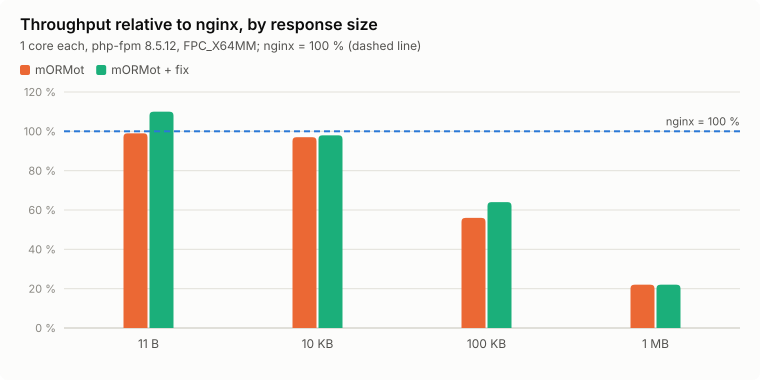

# mORMot 2 FastCGI proxy vs nginx and FrankenPHP

Benchmark of the `fcgi://` source of `THttpProxyServer`, added in
[synopse/mORMot2#785](https://github.com/synopse/mORMot2/pull/785). It answers the question
asked in [that PR](https://github.com/synopse/mORMot2/pull/785#issuecomment-6955274832) about
stability, performance and CPU/RAM usage compared to nginx. The benchmark uses **PHP 8.5.12** with
php-fpm and FrankenPHP, a synthetic PHP workload, and a real Laravel 12 application.

The fix proposed from these measurements is PR_LINK
(commit [`b86a573`](https://github.com/tobfel/mORMot2/commit/b86a573)).

## Summary

- **The mORMot asynchronous HTTP server keeps up with nginx.** On one core, for small PHP
  responses, the proxy matched nginx (97-110 % of its requests/s) with comparable CPU per request.
  On 4 cores it matched nginx with 4 workers. With a real Laravel application, nginx and mORMot are
  within run-to-run noise. Congratulations to Arnaud Bouchez on the HTTP server framework.
- **Stability:** 2 million requests of mixed load, failure injection (php-fpm stopped, clients
  aborting, 5000 connections, saturated php-fpm backlog, script timeout): 0 errors and no crash.
  File descriptors went back to their baseline count.
- **Memory:** without the fix, the proxy's peak RSS went up to **0.8-1.45 GB**, against
  **10-40 MB** with the fix (nginx needs 15-27 MB). Closed one-shot FastCGI connections kept their
  receive buffer while they waited in the connection garbage-collector lists. The fix is 3 lines.
- **Large responses** (100 KB and more) are still slower than nginx: 56-64 % of nginx at
  100 KB and 22 % at 1 MB on one core. The proxy buffers the whole response and crosses several
  threads per request, while nginx streams from one event loop. This is a design topic, not part of
  the fix.
- **Laravel:** no difference between nginx and mORMot in front of php-fpm. FrankenPHP in
  worker mode (Laravel Octane) is 1.5-1.65x faster, as expected without a per-request bootstrap,
  but needs 1.7-1.8x the memory of the php-fpm stacks.
- **Gaps for PHP frameworks:** there is no front-controller fallback (`/page` returns 404, only
  `/index.php/page` works), and static files under the FastCGI root are sent to php-fpm.

All mORMot binaries were built with `FPC_X64MM` (`-dFPC_X64MM -dFPCMM_SERVER`), the
recommended memory manager for servers. The default FPC heap was clearly slower: 10 KB responses
reached 66 % of nginx with it, against 97 % with `FPC_X64MM`.

## Setup

| Item | Version or setting |
|---|---|
| Host | Linux x86_64 VM, 4 vCPU, 16 GB, Ubuntu 24.04, kernel 6.18 |
| mORMot 2 | master [`bbbb264`](https://github.com/synopse/mORMot2/commit/bbbb264) (first runs: `1bc774a`, no change in `src/net` between the two), FPC 3.2.2, `-O3 -dFPC_X64MM -dFPCMM_SERVER` |
| PHP | 8.5.12 built from the `php-8.5.12` tag: NTS + php-fpm, ZTS + embed for FrankenPHP; opcache on, JIT off |
| nginx | 1.24.0, `access_log off`, `fastcgi_pass` on the same unix socket |
| FrankenPHP | v1.13.5 (Caddy v2.11.9), built against the same PHP 8.5.12 |
| Laravel | 12.73.0 + Octane 2.25, `APP_ENV=production`, `artisan optimize`, cookie sessions, no database |
| Load | `wrk` with keep-alive connections, on its own CPU |

- **Synthetic runs:** the proxy (nginx or mORMot) runs pinned to CPU 0, php-fpm (16 static workers)
  to CPU 1-2, and wrk to CPU 3.
- **Laravel runs:** each stack gets CPU 0-2 and 12 PHP workers, and wrk runs on CPU 3.

## 1. Throughput by response size

<picture>
  <source media="(prefers-color-scheme: dark)" srcset="charts/synthetic-throughput-dark.svg">
  
</picture>

Requests per second, 1 core per proxy, c=64 (1 MB: c=16):

| PHP script | nginx | mORMot | mORMot + fix | mORMot CPU per request | nginx CPU per request |
|---|---:|---:|---:|---:|---:|
| `hello.php` (11 B) | 20,166 | 20,020 | 22,248 | 44-48 us | 49 us |
| `json.php` (10 KB) | 15,661 | 15,254 | 15,341 | 61 us | 53 us |
| `big.php` (100 KB) | 9,808 | 5,457 | 6,232 | 158-180 us | 100 us |
| `big.php` (1 MB) | 1,543 | 333 | 338 | 2.6-3.0 ms | 0.64 ms |
| `post.php` (64 KB POST) | 7,317 | 7,639 (FPC heap) | - | 107 us | 81 us |

4 cores, no pinning (nginx 4 workers, mORMot 8 threads), requests per second:

| | nginx | mORMot | mORMot + fix |
|---|---:|---:|---:|
| hello, c=256 | 30,120 | 30,071 | 32,450 |
| json, c=256 | 19,854 | 19,150 | 18,611 |
| 100 KB, c=64 | 14,539 | 9,594 | 12,158 |

Run-to-run noise on this VM is about ±10 %. The same comparison on `bbbb264` is in
[results/synthetic-1core-bbbb264.txt](results/synthetic-1core-bbbb264.txt).

## 2. Memory: the fix

<picture>
  <source media="(prefers-color-scheme: dark)" srcset="charts/memory-peak-dark.svg">
  
</picture>

<picture>
  <source media="(prefers-color-scheme: dark)" srcset="charts/soak-rss-dark.svg">
  
</picture>

**Cause.**
- **One connection per request.** `TFastCgiAsyncConnection` serves a single request, since no
  `FCGI_KEEP_CONN` is set.
- **Closed connections keep their buffer.** Once closed, an instance waits in the
  `TAsyncConnections` GC lists, 100 ms in GC#1 then up to 10 s in GC#2, before it is recycled or
  freed. It keeps its `fRd` buffer meanwhile, which `ReadMaxBytes` (1 MB by default) lets grow to
  the whole response.
- **Instrumented build.** At 5.5 k req/s of 100 KB responses, GC#1 held about **6,000 closed
  instances with 680 MB of `fRd` buffers**, and GC#2 stayed empty, so nothing was recycled under
  load ([results/gc-instrumentation.txt](results/gc-instrumentation.txt)).
- **Not a leak.** The memory goes back to about 10 MB about 10 s after the load stops.

**Fix** (`src/net/mormot.net.proxy.pas`, [fix.diff](fix.diff)):

```pascal
procedure TFastCgiAsyncConnection.OnClose;
begin
  HttpResponse(HTTP_BADGATEWAY); // closed with no frtEndRequest
  fRd.Clear; // one request per connection: don't keep this buffer in the GC
  fResponse.Init;
end;
// in TFastCgiAsyncConnections.Create, after inherited Create:
  fSockets.ReadMaxBytes := 128 shl 10; // parse 64KB records as they come
```

Peak RSS of the front server (MB):

| Scenario | nginx | mORMot | mORMot + fix |
|---|---:|---:|---:|
| 100 KB, 1 core, c=64 | 15 | 806 | 12 |
| 1 MB, 1 core, c=16 | 15 | 871 | 36 |
| 1 MB, 1 core, on `bbbb264` | - | 996 | 36 |
| 100 KB, 4 cores, c=64 | 25 | 1,269 | 15 |
| 3 min mixed load, c=200 | - | 1,446 | 28 |
| Laravel welcome page, c=256 | 27 | 104 | 8 |

The throughput is unchanged within noise; the benefit of the fix is the memory.
The `TNetworkProtocols` regression tests pass with the fix (3 runs, 177,148 assertions, 0 failed).

## 3. Stability (without the fix)

| Test | Result |
|---|---|
| 3 min mixed load (hello, json, 100 KB, POST 64 KB, 20 ms sleep), c=200 | 2.0 M requests, 0 errors, 11.1 k req/s, same as nginx |
| php-fpm stopped under load | immediate 502 (0.6 ms, same as nginx); 200 again right after the restart |
| 2000 clients aborting a 1 MB response after 2 ms | no crash; open file descriptors back to 8 |
| 5000 concurrent keep-alive clients | 19.1 k req/s, no errors |
| php-fpm backlog saturated (2 workers, `listen.backlog=8`, 200 clients on a 1 s script) | HTTP threads not blocked in `connect()`; a non-PHP probe answered in 0.5 ms |
| script running 70 s | 504 after 60.1 s (`FastCgiTimeoutSec`) |
| 2 min Laravel soak, c=100 | 0 errors, stable fds; RSS 73 -> 94 MB without the fix, 8 MB with it |

## 4. Laravel 12 without database

The app has three endpoints, all under the `web` or `api` middleware:
- a JSON API (13.7 KB, a collection of 100 items),
- a Blade page (14.5 KB, with layout, partials, CSRF and 3 encrypted cookies),
- the default welcome page (80 KB).

<picture>
  <source media="(prefers-color-scheme: dark)" srcset="charts/laravel-throughput-dark.svg">
  
</picture>

Requests per second, median of 3 interleaved runs, c=32:

| Endpoint | nginx + php-fpm | mORMot + php-fpm | mORMot + fix | FrankenPHP classic | FrankenPHP worker |
|---|---:|---:|---:|---:|---:|
| JSON API | 648 | 695 | 722 | 634 | 963 |
| Blade page | 522 | 535 | 551 | 506 | 814 |
| Welcome page | 779 | 760 | 716 | 678 | 1,288 |

PHP is the bottleneck here: the front server (nginx or mORMot) used only 12-24 % of the 3 cores.

<picture>
  <source media="(prefers-color-scheme: dark)" srcset="charts/laravel-memory-dark.svg">
  
</picture>

Memory and handles. PSS splits shared pages between processes, so it is the fair measure for
php-fpm, whose workers share the opcache memory.

| | RSS at idle after load | PSS at idle | fds at idle | fds at c=256 | threads |
|---|---:|---:|---:|---:|---:|
| nginx (3 workers) | 26 MB | 16 MB | 49 | 560 | 4 processes |
| mORMot | 12 MB | 10 MB | 8 | 520 | 9 |
| mORMot + fix | 8 MB | 6 MB | 8 | 520 | 9 |
| php-fpm (12 workers, used by both) | 398 MB | 57 MB | 93 | 105 | 13 processes |
| FrankenPHP classic | 143 MB | 103 MB | 9 | 276 | 22 |
| FrankenPHP worker | 161 MB | 121 MB | 21 | 277 | 35 |

## 5. Where the gap for large responses comes from

Measured per request on one core with `FPC_X64MM`:

| | hello | 100 KB | 1 MB |
|---|---:|---:|---:|
| Context switches, mORMot | 7.1 | 17 | 76 |
| Context switches, nginx | 0 | 0 | 0 |
| Minor page faults, mORMot | - | 6-9 | 274-278 |
| Minor page faults, nginx | - | 0 | 1 |

- **Buffering and copies.** The response is buffered completely, copied from `fRd` to
  `TFastCgiResponse.Output`, and moved again by `FastCgiParseOutput`.
- **Thread hops.** Each request passes through an HTTP worker thread, the `fastcgi` reader thread,
  and then the HTTP writer.
- **Profile.** At 100 KB, 78 % of the profile samples are in the kernel, and 37 % of all samples
  are scheduling and wake-ups.

Possible directions, all to be measured:
- streaming large outputs to the client, as nginx does with `fastcgi_buffers`;
- fewer thread hand-offs per request;
- `FCGI_KEEP_CONN` with a pool bounded by the php-fpm workers (see section 6).

## 6. Notes for PHP frameworks and handles

- **No front-controller fallback.** Laravel, Symfony and WordPress rely on
  `try_files $uri /index.php`. With the proxy, `/page` returns 404 and only `/index.php/page`
  works, so Laravel also generates links containing `/index.php`.
- **Static files under the FastCGI root are sent to php-fpm.** `robots.txt` returns 403, from
  php-fpm `security.limit_extensions`, and `favicon.ico` returns the built-in mORMot icon instead of
  the app's file. A "serve the file if it exists, else forward to the front controller" mode would
  cover both points.
- **FastCGI over TCP.** One connection per request left about 8,400 `TIME_WAIT` sockets after
  15 s at 770 req/s, exactly like nginx's default `fastcgi_pass`. Against a remote php-fpm this can
  exhaust ephemeral ports at a few hundred new connections per second.
- **Keeping connections open is not free.** A naive nginx `fastcgi_keep_conn` + `keepalive` setup
  dropped to 245 req/s, a third of the throughput, because idle kept connections block php-fpm
  workers. A future `FCGI_KEEP_CONN` pool in mORMot should be bounded by `pm.max_children`.

## Limits of this benchmark

- One VM, with the load generator on the same host; noise is about ±10 %.
- Linux x86_64 with epoll and FPC only. Windows/IOCP, Delphi builds and aarch64 were not tested.
- FastCGI over a unix socket, except for the TCP handle test in section 6.
- No TLS and no HTTP/2.

## Reproduce

Requirements: FPC 3.2.x, the mORMot static libraries in `static/x86_64-linux`, nginx, wrk,
composer, Go (for FrankenPHP) and the PHP build dependencies listed in `php/build-php.sh`.
All paths below are relative to this folder.

```bash
php/build-php.sh                         # PHP 8.5.12: /opt/php85 (fpm) and /opt/php85zts (embed)
php/build-frankenphp.sh                  # FrankenPHP v1.13.5 -> php/bin/frankenphp
proxy/build.sh upstream                  # proxy/bin/fcgiproxy_upstream (FPC_X64MM)
git apply --ignore-whitespace fix.diff && proxy/build.sh fix && git apply -R --ignore-whitespace fix.diff

# synthetic: proxy + nginx on CPU 0, php-fpm on CPU 1-2, wrk on CPU 3
synthetic/start.sh upstream              # mORMot on :8080, nginx on :8081
synthetic/bench.sh "mORMot 100KB" "$(pgrep -f 'fcgiproxy_upstream 8080')" "http://127.0.0.1:8080/big.php?kb=100" 64 15
synthetic/bench.sh "nginx 100KB" "$(pgrep -f 'nginx: worker')" "http://127.0.0.1:8081/big.php?kb=100" 64 15
synthetic/stop.sh

# Laravel: 5 stacks on CPU 0-2 (nginx :8081, mORMot :8090, mORMot + fix :8095,
# FrankenPHP classic :8086, FrankenPHP worker :8087)
laravel/setup.sh                         # creates /srv/laravel/app
laravel/start.sh
laravel/bench.sh nginx /api/items 32 15
laravel/bench.sh mormot /index.php/api/items 32 15
laravel/bench.sh fworker /api/items 32 15
laravel/stop.sh
```

`proxy/fcgiproxy_stats.dpr` is the build used to inspect the GC lists. It prints the active
FastCGI connections and the buffers held by closed ones every second when `STATS=1` is set.
`charts/make_charts.py` regenerates the charts.

## Files

| Path | Content |
|---|---|
| `proxy/` | minimal `THttpProxyServer` + `AddFastCgi()` program, its instrumented variant, and the build script |
| `php/` | build scripts for PHP 8.5.12 (NTS + ZTS) and FrankenPHP |
| `synthetic/` | PHP scripts, php-fpm/nginx configs, the benchmark driver, wrk Lua scripts, a FastCGI record inspector |
| `laravel/` | app files (controller, views, routes), configs for nginx/php-fpm/Caddy, start/stop/bench scripts |
| `results/` | raw output of every run quoted above |
| `charts/` | SVG charts (light and dark) and their generator |
| `fix.diff` | the proposed fix |

Variant names in `results/synthetic-1core-variants.txt`:
- `mm` is the upstream code with `FPC_X64MM`.
- `A` sets `ReadMaxBytes` to 128 KB.
- `B` grows `Output` geometrically. This variant was rejected because it gave no gain.
- `C` releases the buffers in `OnClose`.
- `AC` is the proposed fix.
- A suffix `mm` means built with `FPC_X64MM`.
